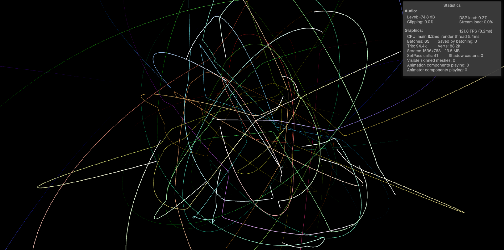
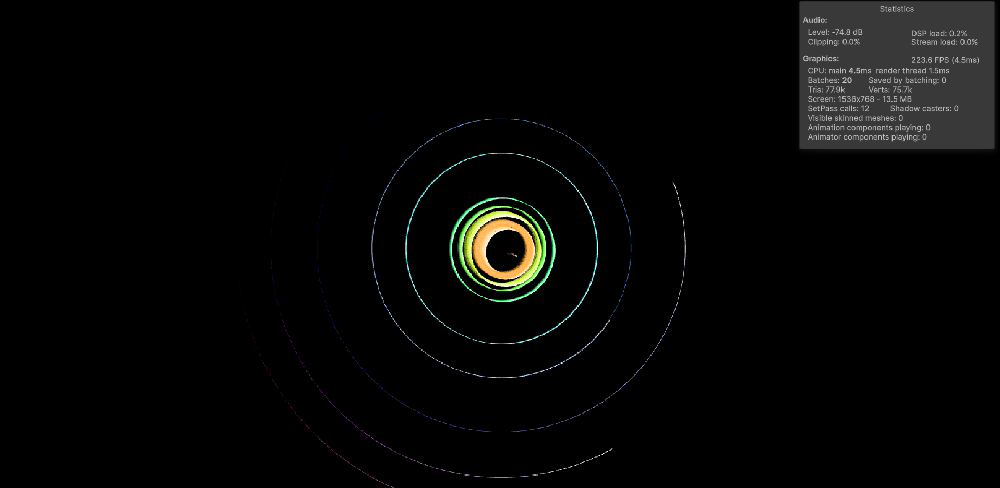

# IMDM327 Fall 2026 Course Material
Fork, Andrew Hu 

Instructor, Myungin Lee

# Assignment 1

Assignment 1 scenes can be found in `Assets\327_CourseMaterial\Scenes\Assignment1` 

Part 1 is in `Scene1` 

Part 2 is in `Scene2`

The "blur" in the inner planets is due to gravitational pull from planets to sun combined with the high timestep and long trail duration.

I had also removed the `Time.deltaTime` component in the solar system scene because dropped frames led to unexpected "shoot offs"